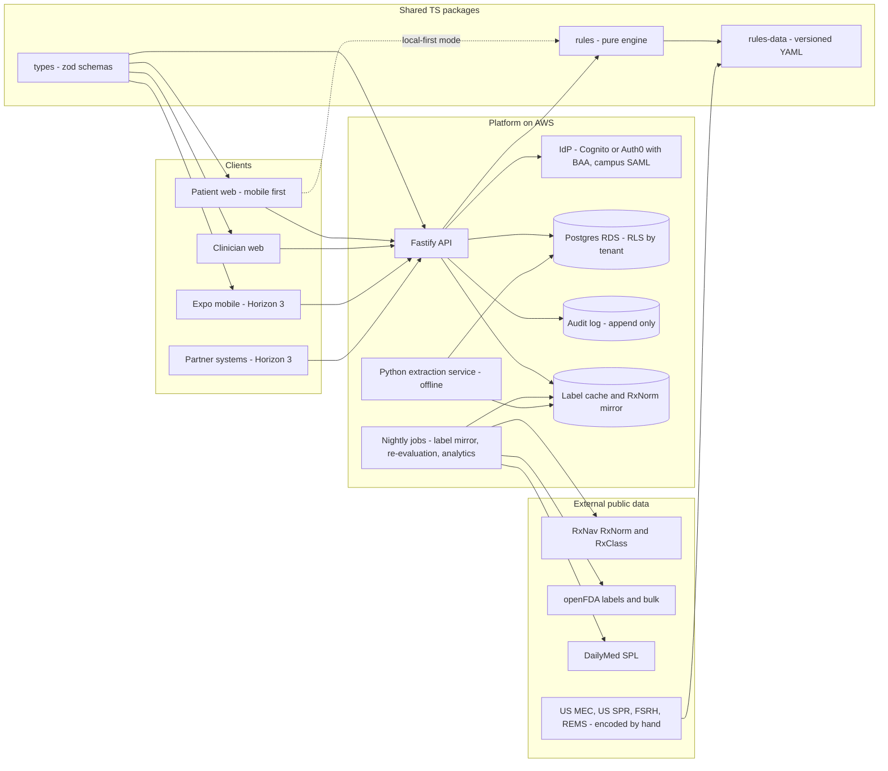
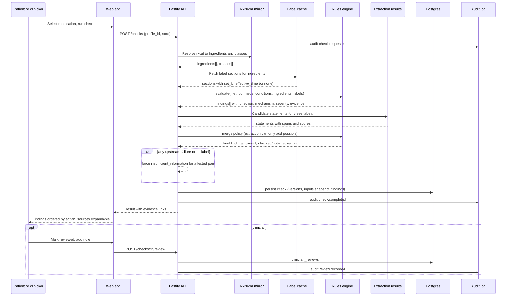

# 02 · Technical architecture

Part of the DownUnder plan. Index: [00-plan-index.md](./00-plan-index.md). What we are building: [01-product-definition.md](./01-product-definition.md). UX layer: [03-frontend-and-ux.md](./03-frontend-and-ux.md). Technical risks in depth: [06-risks-and-ethics.md](./06-risks-and-ethics.md).

Design goals, in priority order: (1) never emit a false "no interaction"; (2) every verdict is traceable to a versioned source; (3) a part-time team of one to three people can ship and maintain it; (4) a campus privacy office can approve it; (5) it can become an API without a rewrite.

## 1. Backend language and framework

### 1.1 Recommendation

Keep TypeScript on Node for the API, the rules engine, and all shared types. Replace Express with Fastify. Add one Python service, offline only, for label NLP extraction. Do not adopt Go.

### 1.2 Tradeoffs considered

| Option | For | Against | Verdict |
|---|---|---|---|
| TypeScript + Fastify | Existing code and team skills are TS; one language across API, web, future React Native; zod schemas become runtime validation, OpenAPI docs, and client types; Fastify is fast enough (tens of thousands req/s, irrelevant at our scale), has first-class schema validation, structured logging (pino), and a plugin model for auth/tenancy; small surface to learn. | Less opinionated than NestJS; discipline needed to keep module boundaries. | Chosen. |
| TypeScript + NestJS | Opinionated DI and modules; good for larger teams; decorators for guards and interceptors (useful for tenancy and audit). | Heavier abstraction for a 1–3 person team; slower iteration; decorator metadata and DI add debugging cost; most of its value appears at 10+ engineers. | Not now. Revisit if the team passes ~6 backend engineers. |
| Go | Single static binary, strong concurrency, low memory, simple deployment; good for a high-volume API gateway. | Our latency is dominated by external calls and database I/O, not CPU; no shared types with the frontend without codegen; hiring and part-time contributor pool for this project is TS-first; rewriting the rules engine twice (TS for the client, Go for the server) is exactly the duplication we want to avoid. | Rejected for now. A Go edge gateway is justified only if the partner API exceeds what Node handles comfortably (thousands of req/s sustained), which is a Phase 4+ problem. |
| Python (FastAPI) for everything | Best ML/NLP ecosystem; clinicians and data scientists can read it. | Loses shared types with the web/mobile clients; two languages in the request path; the rules engine must be callable client-side for a local-first mode, which Python cannot do. | Rejected for the request path; adopted for the offline NLP service. |

Where a second language is justified: the label-extraction pipeline (Python). It runs as a batch job against openFDA/DailyMed labels, writes candidate statements with passage pointers into Postgres, and is evaluated against the gold set. It is never in the request path and never overrides rules. If we later fine-tune a model, the same service hosts inference behind an internal queue. Everything else stays TypeScript.

### 1.3 Repo layout (monorepo, pnpm workspaces + Turborepo)

```
apps/
  api/            Fastify, Drizzle, zod, pino
  web/            Vite + React (patient + clinician), later Next.js only if SEO marketing pages are needed
  mobile/         Expo (Horizon 3)
  extract/        Python label-extraction service (uv, FastAPI for internal endpoints, batch CLI)
packages/
  types/          zod schemas → TS types shared by api, web, mobile
  rules/          pure TS rules engine + table loaders; no I/O; runs in Node and in the browser
  rules-data/     YAML/JSON tables (US MEC, FSRH-derived inducer table, reverse-check list), versioned
  eval/           gold set schema, scoring script, report generator
  ui/             design-system components (Radix primitives + Tailwind), accessible by default
infra/            Terraform or Pulumi (AWS), GitHub Actions
```

## 2. Rules engine design

### 2.1 Tables as data, not code

All clinical knowledge lives in `packages/rules-data` as versioned YAML with a JSON Schema. The engine (`packages/rules`) is a small, pure evaluator. A pharmacist edits YAML in a pull request; CI validates schema, runs the gold set, and blocks merge on any new dangerous miss. Each table carries `version`, `effective_date`, `source`, `reviewed_by`, `review_due`.

Table families:

| Table | Content | Primary sources |
|---|---|---|
| `methods.yaml` | Method taxonomy: category (CHC pill/patch/ring; POP; implant; DMPA injection; LNG-IUD; copper IUD; EC levonorgestrel; EC ulipristal; OTC norgestrel), route, hormone(s), susceptibility flags (hepatic induction, GI absorption, potassium) | US MEC 2024, US SPR 2024, FSRH |
| `inducers.yaml` | Enzyme-inducing drugs by RxNorm ingredient RxCUI, induction strength (strong/moderate/weak), affected method categories, recommended action per category, evidence grade | FSRH CEU drug-interaction guidance; US MEC 2024 table on CYP inducers; FDA labels |
| `reverse_effects.yaml` | Hormonal contraception altering another drug (lamotrigine, some antiretrovirals, cyclosporine, theophylline, etc.) | FSRH, labels |
| `absorption.yaml` | Drugs that impair oral absorption or timing (e.g., GLP-1/GIP agonists per tirzepatide label; orlistat; severe vomiting/diarrhea guidance) | Labels, US SPR |
| `mec_conditions.yaml` | US MEC categories (1–4) for method × condition (age ≥35 and smoking, migraine with aura, hypertension, VTE history, breastfeeding, etc.) | CDC US MEC 2024 |
| `ec_interactions.yaml` | Ulipristal then hormonal method (wait 5 days), inducers and EC dose | FSRH, labels |
| `needs_contraception.yaml` | Drugs where reliable contraception is recommended/required: REMS (isotretinoin, mycophenolate, thalidomide analogs), PLLR label statements, classes (valproate, methotrexate, warfarin, ACEi/ARB, leflunomide, ribavirin, topiramate …) | FDA REMS pages, labels, ACOG/FSRH guidance |
| `class_map.yaml` | RxClass mappings used for class-level rules (ATC, EPC, MoA via RxClass API) | NLM RxClass |

Rule row (illustrative):

```yaml
- id: inducer.rifampin.chc
  subject: { rxcui: 9384, name: rifampin, role: inducer, strength: strong }
  object_method_categories: [chc_pill, chc_patch, chc_ring, pop, implant]
  direction: subject_reduces_object_efficacy
  mechanism: cyp3a4_induction
  severity: known_interaction
  action: "Use a method not affected by enzyme inducers (IUD, DMPA) or add condoms during and for 28 days after."
  evidence:
    - { type: guideline, source: FSRH_CEU_DI_2022, section: "Table 2" }
    - { type: label, set_id: "<openFDA set_id>", section: drug_interactions, quote_hash: "…" }
  not_affected_methods: [lng_iud, copper_iud, dmpa]
  version: 2026.11
```

### 2.2 Evaluation flow

1. Normalize inputs: each medication → RxNorm ingredient RxCUI(s) (MIN expanded to INs); method → `methods.yaml` category; profile facts → MEC condition keys.
2. Pairwise evaluation: (a) each medication vs method, both directions; (b) each medication vs each other medication for the small set of contraception-relevant pairs we curate (we do not attempt general DDI coverage in v1 and we say so in the UI); (c) method vs MEC conditions; (d) each medication vs `needs_contraception` given the method's reliability class.
3. Evidence assembly: for each hit, attach rule row id, table version, and resolved citations (label passage text fetched from the cached label store).
4. Confidence and abstention (see 2.4).
5. Compose result: ordered list of findings, each with direction, mechanism, severity, action, evidence; an overall "what to do now" line; and an explicit list of what was checked and what was not.
6. Persist a `check` record with rules version, label versions, engine version, and the full finding set (for audit and re-evaluation when tables change).

### 2.3 Direction and mechanism vocabulary

- Directions: `med_reduces_method_efficacy`, `method_alters_med_levels`, `med_impairs_method_absorption`, `method_contraindicated_by_condition`, `med_requires_reliable_contraception`, `med_med_interaction_contraception_relevant`.
- Mechanisms: `cyp3a4_induction`, `ugt_induction`, `gi_absorption`, `potassium`, `pharmacodynamic`, `teratogenic_risk`, `unknown`.
- Severities (output vocabulary; see [03-frontend-and-ux.md](./03-frontend-and-ux.md) §5): `known_interaction` (act), `possible_interaction` (check), `none_known_in_sources`, `insufficient_information` (ask a pharmacist). The word "safe" and the level "Low" do not exist in the schema.

### 2.4 Confidence and abstention

Deterministic first:
- A finding from a curated table with guideline evidence is `known` or `possible` per the row; confidence is not a probability, it is an evidence grade (guideline / label / extraction-only / class-inferred).
- `none_known_in_sources` requires: ingredient resolved; at least one authoritative label successfully retrieved and parsed for the medication; no table hit; no extraction hit above threshold. If any of those fails, result is `insufficient_information`.
- Any upstream error, timeout, or empty label section → `insufficient_information`, never `none_known`.
- Unresolved ingredient (typeahead name without RxCUI, supplement without RxNorm concept) → `insufficient_information` with "we could not identify this product reliably".

Learned second (Horizon 1 N14): the extraction model produces candidate statements with a calibrated score and passage pointer. Policy: extraction can raise a `none_known` to `possible_interaction` (and show the passage), can never lower a table finding, and can never produce `known_interaction` without a table row. Abstention rate and false-reassurance rate are tracked as first-class metrics in the eval harness.

### 2.5 Versioning

Every check stores `engine_version`, `rules_data_version`, and the `set_id`/`effective_time` of each label used. When tables change, a batch job re-evaluates recent checks and flags verdict changes for clinician notification (Horizon 2 S8).

## 3. Data model (Postgres)

Postgres 16 on a managed service that signs a BAA (AWS RDS to start). ORM: Drizzle (type-safe, SQL-transparent, migrations as SQL files). Prisma is an acceptable alternative; Drizzle chosen for lighter runtime and clearer SQL in audits.

Core tables (abridged):

| Table | Key columns | Notes |
|---|---|---|
| `tenants` | id, name, type (campus/telehealth/pharmacy), privacy_regime (hipaa/ferpa/state/consumer), data_region, retention_days | Row-level security keyed on tenant |
| `users` | id, tenant_id nullable (consumer accounts have none), role (patient/clinician/admin), auth_subject, created_at | No name required for patient accounts |
| `consents` | user_id, purpose (service/analytics/clinician_share), version, granted_at, revoked_at | Append-only |
| `profiles` | id, user_id, dob_year_month (not full DOB), smoker, bmi_band, condition_flags[] | Data minimization: bands, not raw height/weight unless needed |
| `profile_methods` | profile_id, method_code, started_on, ended_on | History, not single slot |
| `profile_medications` | profile_id, rxcui_input, ingredient_rxcuis[], display_name, source (search/manual/import), active | Fixes today's unkeyed table |
| `checks` | id, profile_id, requested_by (patient/clinician), engine_version, rules_version, inputs_snapshot jsonb, findings jsonb, overall, created_at | Immutable |
| `clinician_reviews` | check_id, clinician_id, outcome (confirmed/dismissed/advised), note, created_at | Pilot metric source |
| `label_cache` | set_id, rxcui[], ingredient_rxcuis[], effective_time, sections jsonb, fetched_at | openFDA/DailyMed mirror |
| `extractions` | label set_id, section, span, statement_type, score, model_version | Output of Python service |
| `rules_releases` | version, git_sha, reviewed_by, released_at | |
| `audit_events` | actor, action, object_type, object_id, tenant_id, ip_hash, at | Append-only, separate schema, write-only role from API |
| `analytics_daily` | tenant_id, date, metric, value | De-identified aggregates only; suppress counts <10 |

PHI is confined to `profiles`, `profile_*`, `checks`, `clinician_reviews`. Everything else is reference data. Column-level encryption (pgcrypto or application-level envelope encryption via KMS) for free-text notes; disk encryption everywhere.

Migration from sql.js: there is no production data to migrate (one committed sample profile). Port the schema and seeds, drop the `id = 1` constraint, key medications to profiles, and delete the committed `.sqlite` and `dist/` from the repo.

## 4. Drug data sources that work today

Verified live on 2026-11-07 (extract §3.4) or documented as currently available (verify before relying):

| Source | Status | Use |
|---|---|---|
| RxNav RxNorm API: `/REST/drugs.json?name=`, `/REST/approximateTerm.json`, `/REST/rxcui/{id}/properties.json`, `/REST/rxcui/{id}/related.json?tty=IN+MIN+PIN`, `/REST/rxcui/{id}/allrelated.json` | Live | Typeahead, normalization to ingredient, TTY resolution. ~20 req/s limit; cache aggressively. |
| RxNav RxClass API: `/REST/rxclass/class/byRxcui.json` | Live | Class membership (ATC, EPC, MoA, VA) for class-level rules. |
| RxNorm monthly full release (UMLS license, free) | Available | Load into Postgres for offline normalization; removes runtime dependency on RxNav for the common path. Recommended by Phase 1. |
| RxNav `/REST/interaction/*` | Retired 2024-01-02; 404 verified | Do not call. |
| openFDA `drug/label.json` with `search=openfda.rxcui:"<rxcui>"` or `openfda.substance_name:"<ING>"` | Live | Label sections: `drug_interactions`, `contraindications`, `warnings_and_cautions`, `use_in_specific_populations`, `pregnancy`, `boxed_warning`, with `set_id`, `effective_time`, `version`. Unauthenticated limit is low; use an API key (free) and cache. Query by RxCUI/ingredient, not display name. |
| openFDA bulk label download | Available | Nightly mirror into `label_cache`; the request path never calls openFDA synchronously. |
| DailyMed SPL web services (`/services/v2/spls.json?rxcui=`) and SPL downloads | Available | Secondary label source and SPL XML for section-accurate extraction. |
| CDC US MEC 2024 and US SPR 2024 | Public | Encoded into `mec_conditions.yaml` and missed-dose guidance by hand, reviewed by advisor. |
| FSRH CEU "Drug Interactions with Hormonal Contraception" | Public (UK guideline) | Primary structured source for inducer table; cross-check with US labels. |
| FDA REMS pages (iPLEDGE, mycophenolate, thalidomide analogs) | Public | `needs_contraception.yaml` seeds. |
| NLM LactMed (Bookshelf) | Public | Horizon 3 lactation module. |
| Licensed: DrugBank Clinical API, First Databank MedKnowledge, Wolters Kluwer Medi-Span / Lexicomp API, Merative Micromedex, Elsevier Gold Standard | Commercial; pricing confidential (estimate: five to low-six figures per year for a startup API license, confirm with vendors) | Option for general DDI coverage behind the same engine (Horizon 2 S9). Redistribution terms matter for a patient-facing display; negotiate explicitly. DrugBank academic download is not licensed for an app. |
| Open research sets (ONC high-priority DDI list, Flockhart CYP table, DDInter) | Public | Cross-checks and candidate generation for the curated table, not direct user-facing evidence. |

Decision recommended: Phase 0 ships on curated tables + mirrored labels. Decide on a commercial license at Gate 2 based on pilot scope and coverage gaps measured by the gold set.

## 5. AI scope

In scope (Horizon 1 N14): label NLP extraction. Input: label sections from `label_cache`. Output: statements typed as `reduces_contraceptive_efficacy`, `backup_method_recommended`, `contraindicated_with_contraceptive`, `contraception_required_during_use`, `alters_other_drug_levels`, with span offsets and a score. Approach ladder: (1) pattern + sentence classifier baseline (spaCy, scikit-learn) to beat first; (2) an LLM with constrained JSON output, few-shot prompted, run offline against the mirror with strict citation of spans; (3) fine-tuned small model if volume justifies. Evaluate all against the gold set with the same harness as the rules.

Rules of engagement:
- Extraction never overrides a table row; it can only add `possible_interaction` with a visible passage.
- No patient data is sent to any third-party model. Extraction runs on public label text only. If a hosted LLM is used for extraction, it processes labels, not profiles.
- No generative text in patient-facing results. Guidance strings come from reviewed templates.
- Cohort analytics and adherence models (Horizon 3) are only on consented, de-identified data and are gated by data volume.

## 6. Auth, tenancy, PHI handling, compliance posture

### 6.1 Auth
- Patients: email + passkey (WebAuthn) or magic link; no password requirement; optional pseudonymous account (no name). Use a HIPAA-eligible managed IdP (AWS Cognito is HIPAA-eligible and supports SAML federation; Auth0 with a BAA is an alternative) behind a thin interface so it can be swapped.
- Clinicians and admins: institution SSO via SAML/OIDC (InCommon/Shibboleth is common on campuses), MFA enforced, role claims mapped to tenant roles.
- Service-to-service and partner API: OAuth 2 client credentials, scoped tokens, rate limits per client.
- Session: short-lived JWT + refresh with rotation; device-bound where passkeys are used.

### 6.2 Tenancy
Row-level security in Postgres on `tenant_id`; API sets the tenant context per request; consumer accounts live in a null-tenant partition and can later link to an institution with explicit consent.

### 6.3 PHI and privacy regimes
- A campus health center that bills electronically is typically a HIPAA covered entity; student treatment records may instead fall under FERPA's treatment-records exclusion. Which applies depends on the center. The product supports both: sign a BAA where HIPAA applies; sign a FERPA-compliant service agreement (school official exception) where FERPA applies. Counsel confirms per pilot. State laws (e.g., Washington My Health My Data Act, effective 2024; Nevada; Connecticut amendments) regulate consumer health data outside HIPAA; the consumer front door must comply regardless.
- Data minimization by schema: year-month of birth, BMI band, condition flags; no free-text except clinician notes (encrypted).
- Reproductive-health-specific: see [06-risks-and-ethics.md](./06-risks-and-ethics.md) §3. Architecture choices: US-only data residency to start; tenant-configurable retention with short defaults (checks purged after 90 days for consumer accounts unless the user opts to keep history); no third-party analytics SDKs; no advertising identifiers; subpoena response policy drafted with counsel before launch.
- Local-first option preserved: `packages/rules` runs in the browser; a "no account" mode can evaluate against a bundled rules snapshot and mirrored label excerpts without sending the profile to the server. Keep this as a differentiator and as the default for the consumer front door until the user chooses to save.

### 6.4 Audit logging
Append-only `audit_events` written through a dedicated DB role; events for login, consent change, profile read/write, check run, clinician review, export, delete, admin actions. Clinician access to a patient record is logged and visible to the patient ("who viewed my data"). Logs shipped to immutable storage with 6-year retention where HIPAA applies.

### 6.5 FDA non-device CDS posture
Design to the four statutory criteria (21st Century Cures Act §3060; FDA CDS guidance, revised January 2026 per the extract): (1) no images/signals; (2) displays and analyzes medical information including clinical guidelines; (3) supports or provides recommendations to a healthcare professional; (4) the professional can independently review the basis. Concretely: the clinician view is the primary regulated-posture product and always shows the source passage and guideline table; the patient view presents findings as "information to discuss with a pharmacist or clinician", with the same evidence, and avoids patient-specific directive language ("stop taking", "you are protected"). Enforcement discretion for low-risk patient-facing information tools is possible but is not assumed; counsel reviews the patient copy before pilot. Record this analysis in a design-history-style document even though we are not filing.

## 7. Deployability, CI, testing

### 7.1 Deployment
- Containers for `api`, `web` (static), and `extract`. Start on AWS: ECS Fargate (api, extract jobs), RDS Postgres (Multi-AZ at pilot), S3 + CloudFront (web), KMS, Secrets Manager, CloudWatch. All HIPAA-eligible services under the AWS BAA. Infra as code from day one.
- Environments: `dev`, `staging` (synthetic data only), `prod`. No PHI in non-prod.
- Observability: pino structured logs with PHI redaction at the logger, OpenTelemetry traces, uptime checks, error budget alert on `insufficient_information` rate spikes (a proxy for upstream breakage).

### 7.2 CI (GitHub Actions)
On every PR: typecheck, lint (ESLint for api and web; ruff/mypy for extract), unit tests, rules-data schema validation, gold-set evaluation with thresholds (fail on any new dangerous miss; warn on precision/recall regression >1 pt), accessibility checks (axe) on key screens, dependency and container scanning, OpenAPI diff. On main: build, deploy to staging, Playwright E2E, manual approval to prod.

### 7.3 Testing pyramid
- `packages/rules`: property and table-driven tests; every YAML row has at least one positive and one negative test case generated from the row itself.
- API: contract tests from OpenAPI; integration tests against ephemeral Postgres (Testcontainers); failure-injection tests proving that any upstream failure yields `insufficient_information`.
- Web: component tests (Testing Library), E2E (Playwright) for the patient check flow and clinician review flow, axe audits.
- Extraction: evaluation notebooks are not tests; the harness is.

### 7.4 Gold-set validation harness (`packages/eval`)
- Schema per item: medication (RxCUI), method category, profile facts, expected severity, expected direction, expected mechanism, evidence citation, labeler id, adjudication status, "dangerous if missed" flag.
- Target: 150–300 items; stratified across method categories, inducers, reverse effects, absorption, MEC conditions, reverse-check drugs, and deliberately boring pairs (most antibiotics) to measure false alarms.
- Metrics: per-severity precision/recall; dangerous-miss count (expected `known` returned as `none_known`); false-reassurance rate; abstention rate overall and on items with evidence available; inter-labeler agreement (kappa) on a double-labeled subset.
- Output: one Markdown/HTML table checked into the repo per release and reused in the deck ([05-pitch-and-influence-playbook.md](./05-pitch-and-influence-playbook.md) slide 5).

## 8. Platforms and why this order

1. Responsive web first (patient and clinician). No app-store gating during pilot; one deploy; works on campus kiosks and clinician desktops; easiest for privacy review (no device permissions). Clinician view is desktop-first; patient view is mobile-first.
2. Native mobile via Expo after Gate 3. Justified when retention data shows repeat use that benefits from push reminders (S3), offline access, or passkey convenience. Shares `packages/types`, `packages/rules`, and `packages/ui` logic; UI components adapt. Expo EAS handles builds; app-store review adds a privacy-label obligation we will meet by design.
3. Partner API and SMART on FHIR after Gate 4 as the distribution layer.

## 9. Architecture diagram



## 10. Data-flow diagram (one check)



## 11. Migration path from the current repo

| Step | Action | Outcome |
|---|---|---|
| 0 | Repo hygiene: delete `backend/dist`, committed `.sqlite`, duplicate seeds, template README; proper `.gitignore`; add CI skeleton; commit the roadmap PDF under `doc/`. | Clean baseline. |
| 1 | Remove the RxNav interaction call; wrap all upstream calls; return `insufficient_information` on failure; fix frontend hang on non-JSON errors. | App stops 500ing; false "Low" removed by changing the vocabulary. |
| 2 | Introduce `packages/types` and `packages/rules`; move `scoreRiskFromTexts` out and replace with table evaluator over a first `inducers.yaml` (rifampin, carbamazepine, phenytoin, phenobarbital, primidone, oxcarbazepine, topiramate, efavirenz, St John's wort, griseofulvin, bosentan, modafinil, rifabutin) and `reverse_effects.yaml` (lamotrigine). | A real, reviewable engine with a dozen correct rows beats the keyword heuristic. |
| 3 | RxNorm normalization service with cache; fix openFDA query to `openfda.rxcui`/ingredient; store `set_id` and passages. | Evidence trail exists. |
| 4 | Swap Express for Fastify (routes are ~310 lines; a day's work); zod schemas shared; pino logging; error handler. | Production-shaped API. |
| 5 | Postgres with Drizzle; new schema (§3); seed methods; remove sql.js. | Deployable data layer. |
| 6 | Gold set v0 (50 items) and harness in CI; grow to 150–300 with advisor. | Gate 1 metric. |
| 7 | Accounts, consent, tenancy, audit log; clinician view v1. | Pilot-ready. |
| 8 | Python extraction service against the label mirror; benchmark. | Gate 2 metric. |
| 9 | Infra as code; staging and prod on AWS; pen test. | Security review. |

Steps 0–3 are a few evenings of work and produce the first honest demo. Steps 4–6 are Phase 0. Steps 7–9 are Phase 1.

## Progress log

- 2026-11-07: Initial draft.
