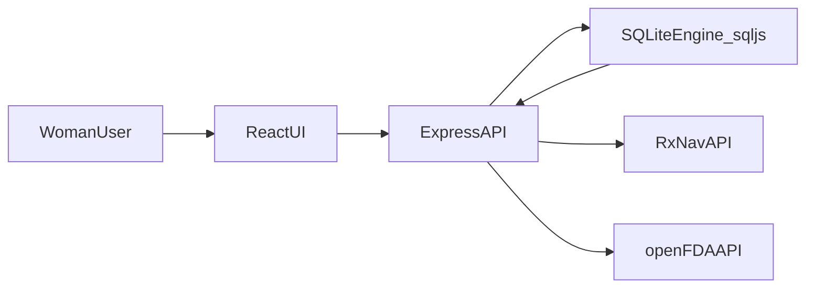

# DownUnder System Architecture

- `ReactUI` handles profile entry, birth control selection, medication management, and interaction searches.
- `ExpressAPI` centralizes profile/catalog CRUD and interaction-check orchestration.
- `SQLiteEngine_sqljs` stores local profile data, seeded birth control methods, meds catalog, and check history.
- `RxNavAPI` provides medication lookup and interaction graph data.
- `openFDAAPI` provides label text for contraception interactions and for adverse effects on the body (boxed warning, adverse reactions, warnings, contraindications). The current app reads those sections in `apps/api`; the diagram above describes the retired Express shell.
